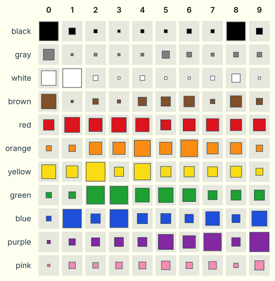
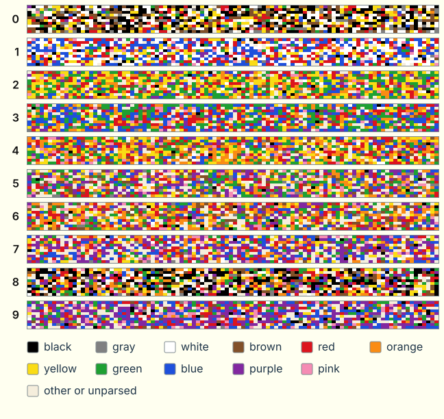

# LFM3 synesthesia

A digit-color association test for language models, with the data, analysis code and results from running it on Liquid AI's [LFM3-1.7B](https://huggingface.co/LiquidAI/LFM3-1.7B).

The test follows the procedure used to screen people for grapheme-color synesthesia. The model sees the digits 0 to 9 in a random order and names one color for each. Over 1,000 shuffled orders, LFM3-1.7B gives each digit its own palette of colors rather than a single fixed color.

**LFM3-1.7B names black for 0 and 8, and purple for 7 and 9.**
Share of 1,000 sampled answers per digit naming each basic color. Square area is the share; a full square is 30%.



Source: `data/battery_v2`. LFM3-1.7B instruct (revision `40ebe0a`), temperature 1, 1,000 shuffled digit orders, 10,000 answers. Swatches stand in for the color words; they are not colors the model produced.

**No digit has a single color: every band mixes many.**
The same 10,000 answers, one tile per answer. Each digit's band holds its 1,000 answers in run order, down each column and then left to right.



Source: `data/battery_v2`, as above. Unlike the grid, the mosaic keeps the 1,416 off-palette and unparsed answers, drawn in beige.

## Results

- **Each digit has its own palette.** Cramér's V between digit and named color is 0.26. Shuffling the digit labels within each run gives a 95th percentile of 0.039 (p = 0.0001, 10,000 shuffles).
- **It is a distribution, not one color per digit.** The most-named color takes 16% to 27% of a digit's answers. Black goes almost only to 0 and 8: 491 of 603 black answers, and at most 3.1% for any other digit.
- **It replicates.** An earlier battery on 60 different orders gives the same digit profile (r = 0.97).
- **It lives in color words, not color values.** Asked for hex codes instead (60 orders), the model's codes were no more consistent per digit than the same codes shuffled between digits (CIELUV battery score 358 vs 366, p = 0.10).

<!-- palette-table:start -->
| Digit | Most named | Second |
| ---: | --- | --- |
| 0 | black 24.9% | brown 15.3% |
| 1 | white 24.9% | blue 24.3% |
| 2 | yellow 25.7% | green 22.3% |
| 3 | blue 22.6% | green 22.2% |
| 4 | yellow 19.1% | orange 18.4% |
| 5 | purple 16.1% | green 15.3% |
| 6 | orange 19.8% | green 11.8% |
| 7 | purple 21.8% | blue 13.5% |
| 8 | black 24.2% | orange 9.4% |
| 9 | purple 26.9% | blue 16.0% |
<!-- palette-table:end -->

Shares are out of 1,000 answers per digit. Off-palette words such as violet and indigo count as "other", so purple shares are lower bounds. [PROTOCOL.md](PROTOCOL.md) has the full design, statistics, and the predictions written before each run, including the ones that failed.

These are word choices from one model. They say nothing about perception or experience, and meeting or missing a human cut-off is a ruler here, not a diagnosis.

This test is one chapter of [Inside LFM3](https://shelltoho.me/pubs/inside-lfm3/), a longer write-up that follows LFM3 from its architecture to its behavior.

## Reproduce the analysis

Needs [uv](https://docs.astral.sh/uv/) and Python 3.12. No model, GPU or download.

```sh
uv run python scripts/verify.py
```

It checks the data against `data/SHA256SUMS`, confirms the helper modules are the ones the runs used, re-runs both analyses from the saved answers and compares the outputs byte for byte, and checks that the figure and table above match the data.

## Run the battery

The original runs used one NVIDIA RTX 4090 in float32 with TF32 off, PyTorch 2.9.1 and Transformers 5.21.0. Battery v2 took 564 seconds, including model loading.

```sh
uv sync --extra run
uv run python scripts/battery_v2.py --stage dry-run                                 # tokenizer only
uv run python scripts/battery_v2.py --stage run --device cuda --output runs/battery_v2
uv run python scripts/battery_v2.py --stage report --output runs/battery_v2
```

The run checks itself before collecting answers: padded and single-sequence log-probabilities must agree within 0.001 nats, and greedy answers must be identical batched and one order at a time. `--quick` runs 10 orders as a smoke test. `scripts/battery_v1.py` takes the same stages and runs both formats, both decoding modes, and the base model.

## Test another model

Keep the prompt, scaffold, decoding, parser and statistics in [PROTOCOL.md](PROTOCOL.md) fixed so results compare across models, and write down predictions before running. The model-specific parts are in `scripts/battery_v1.py`, which `battery_v2.py` imports:

| What | Where | LFM3 value |
| --- | --- | --- |
| Checkpoint and revision | `MODELS` | `LiquidAI/LFM3-1.7B` at `40ebe0aa`, base `LiquidAI/LFM3-1.7B-Base` at `545fc8f4` |
| Chat prompt | `prefix()` | `apply_chat_template(..., enable_thinking=False)` |
| Raw-text prompt | `BOS` | `<\|startoftext\|>` |
| End-of-turn and banned token IDs | `IM_END`, `THINK`, `END_THINK` | 124900, and 124901/124902 for `<think>`/`</think>` |
| Palette tokens | `palette_ids()` | Requires " red" and " Red" to be single tokens; other tokenizers may need multi-token scoring |
| Forward pass | `last_logprobs()` | `model.model(...)`, then `model.lm_head` |

The reference palette in `data/reference` comes from an earlier LFM3 likelihood test. For another model, its correlation with that palette measures agreement with LFM3, not with a ground truth.

## Contents

| Path | What it holds |
| --- | --- |
| `PROTOCOL.md` | Design, statistics, predictions and outcomes for both batteries |
| `scripts/battery_v1.py`, `battery_v2.py` | The scripts that produced the data (run and report stages) |
| `scripts/verify.py`, `figure.py` | Reproduction checks; the two figures and the table above |
| `src/lfm3lab/` | Prompt, parsing and color helpers, unchanged from the runs |
| `data/` | Answers, run settings and analyses; see [data/README.md](data/README.md) |
| `vendor/warm-precision-kit/` | Figure style from the [Warm Precision kit](https://github.com/xmattwest/warm-precision-kit) (MIT) |

## License and citation

Code is under the [Apache License 2.0](LICENSE). Data in `data/` is under [CC BY 4.0](data/LICENSE). The answers were generated with LFM3 models, which are released under the LFM Open License v1.0. This project is not affiliated with or endorsed by Liquid AI. To cite it, use [CITATION.cff](CITATION.cff).
